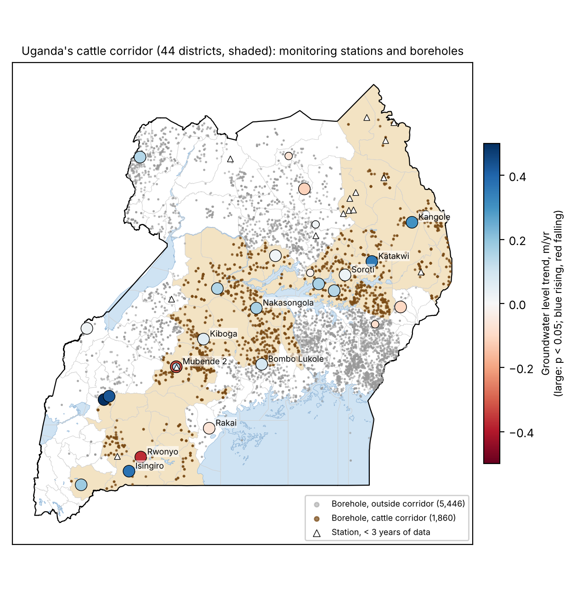
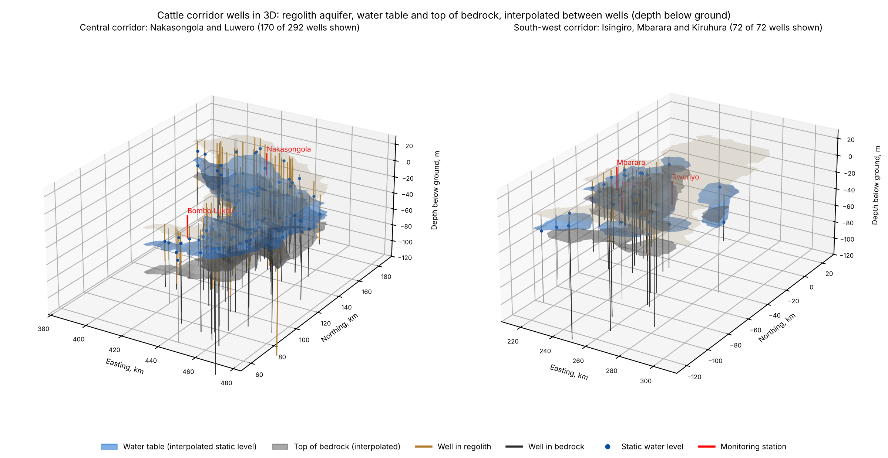
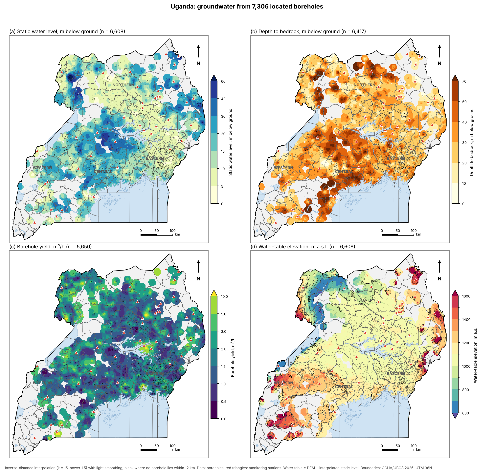
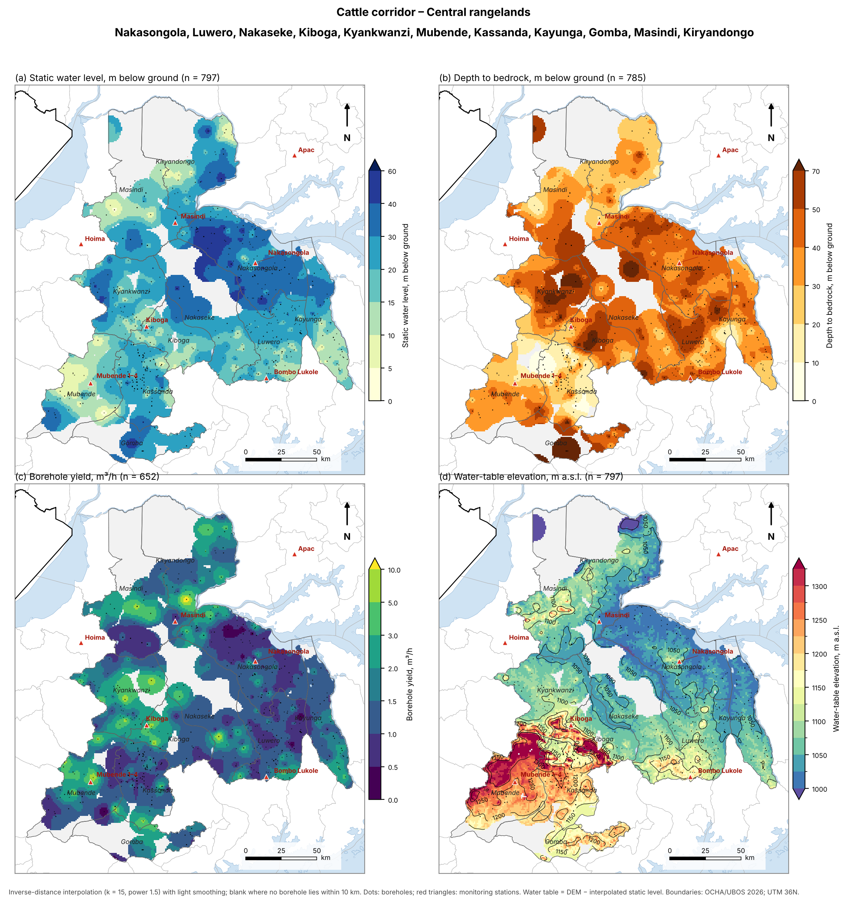
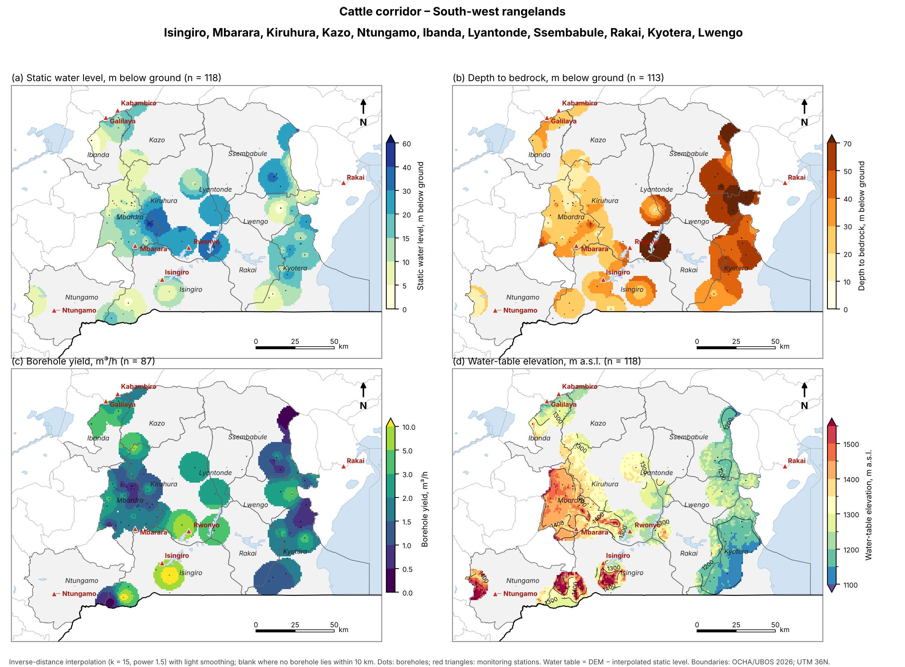
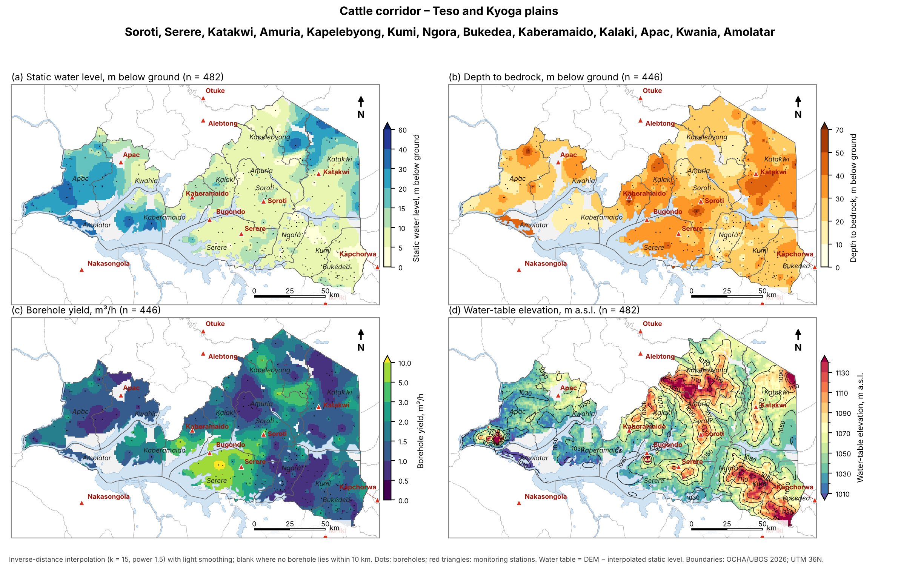

# Groundwater intelligence for Uganda's cattle corridor

**Integrating monitoring science, open digital technology and drought policy for sustainable dryland water security**

[](https://doi.org/10.5281/zenodo.23725130)

Code, notebooks, derived results and figures for the book chapter

> Nafula M., Kakooza C. (2026). *Groundwater intelligence for Uganda's cattle corridor: integrating monitoring science, open digital technology and drought policy for sustainable dryland water security.* Zenodo. https://doi.org/10.5281/zenodo.23725130

The chapter is in [`docs/Nafula_et_al_2026_Groundwater_Uganda_chapter.pdf`](docs/Nafula_et_al_2026_Groundwater_Uganda_chapter.pdf).



## What it does

An open **groundwater digital twin** that runs from data to decisions:

| Data | Models | Indicators | Decisions |
|---|---|---|---|
| 48 monitoring stations (daily levels) | Pastas: recharge plus trend | Standardised Groundwater Index (SGI) | drought bulletins, anticipatory action triggers |
| National borehole database (12,529 records; 7,306 located) | 2D map-view and 3D well interpolation | monthly drought thresholds (P50/P80/P90) | abstraction permits, safe pumping |
| 5,052 Aswa drilling logs | GemPy 3D geological model | level trends (Theil–Sen, Mann–Kendall) | borehole siting, drilling depth, solar pumping |
| ERA5-Land, DEM, 2026 admin boundaries, lakes | well location QA (UTM zone and hemisphere checks) | aquifer geometry: water table, regolith, bedrock | network design, datum maintenance |

## Main results

- In the cattle corridor (44 districts, 1,860 located boreholes), the median water level is 16 m below ground, against 10 m in the rest of Uganda. A quarter of boreholes in the central rangelands and Karamoja have water deeper than 30 m.
- Of 18 corridor stations, 15 show significant trends: 12 rising after the wet years 2019–2024 and 3 falling. **Rwonyo** (Kiruhura) is falling by −0.37 m/yr since 2000 and was in groundwater drought in Dec 2025; Mubende 1 and 2 are abstraction wells.
- Pastas explains ≥60% of level variance at 10 of 18 corridor stations (up to 97%).
- Station-specific drought thresholds and the SGI are given for all 28 stations with at least three years of data.



**Groundwater atlas**: Uganda and each corridor sub-region in map view (water level, bedrock, yield, water table), with district names and stations.

| | |
|---|---|
|  |  |
|  |  |

## Repository layout

```
scripts/                       pipeline, run in order by run_all.py
  get_era5_pev.py              ERA5-Land pev, tp, t2m download (CDS API)              [optional]
  extract_era5_to_stations.py  daily ERA5-Land at each station                         [optional]
  borehole_stats.py            national borehole statistics
  borehole_locate.py           locate boreholes (UTM zone/hemisphere tested against district)
  litho_prep.py                lithology classification and layer picks (+DEM)
  pastas_trend_drought.py      Pastas + trend, Theil–Sen/Mann–Kendall, SGI, thresholds
  gempy_kitgum.py              GemPy regolith model, Kitgum–Pader
  cattle_corridor.py           corridor map, 3D wells, interactive 3D
  regional_maps.py             atlas: Uganda, corridor and sub-regions in map view
  corridor_maps.py             full-page corridor maps per variable
  make_framework.py            framework diagram
  make_maps.py                 district and Aswa maps (2026 admin boundaries)
  make_paper_figures.py        SGI panel, model figures, borehole statistics
  get_admin_boundaries.py      OCHA/UBOS boundaries from HDX or a local copy
  legacy/                      first exploratory scripts
notebooks/        01 borehole database · 02 Pastas, trends, drought · 03 regolith and GemPy · 04 cattle corridor 2D/3D
data/processed/   derived results used in the chapter (no individual boreholes; see data/README.md)
figures/          chapter figures (paper/), full-page atlas maps (maps/), SGI and Pastas plots
docs/             the chapter (PDF)
```

## How to run

The raw data are not public (see below). With access to them:

```bash
conda env create -f environment.yml
conda activate gwchapter
python scripts/get_admin_boundaries.py      # or pass a local folder with uga_admin*.shp
python scripts/run_all.py                   # --era5 re-downloads ERA5-Land; --no-gempy skips GemPy
```

On Windows, double-click `RUN_ALL.bat`. The full run takes about 10 minutes (GemPy accounts for most of it).

## Data availability

Monitoring, borehole and drilling-log data belong to the **Ministry of Water and Environment (MWE), Uganda**, and are not redistributed here; they are available on request from the Directorate of Water Resources Management. Derived results are in `data/processed`. Administrative boundaries: OCHA/UBOS COD-AB via the [Humanitarian Data Exchange](https://data.humdata.org/dataset/cod-ab-uga) (CC BY-IGO). ERA5-Land: Copernicus Climate Change Service.

## Authors

- **Monica Nafula**, KAI Water & Energy, Kampala, Uganda (corresponding author)
- **Charles Kakooza**, Ministry of Water and Environment, Uganda

Built with open-source Python: [Pastas](https://pastas.dev), [GemPy](https://www.gempy.org), GeoPandas, rasterio, Plotly.

## Citation and licence

Cite the chapter (DOI above) and see `CITATION.cff`. Please also cite Pastas (Collenteur et al. 2019) and GemPy (de la Varga et al. 2019). Code is MIT-licensed; the chapter, figures and text are CC BY 4.0; for data, see above.
